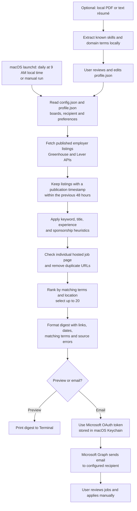

# Daily Job Digest

A macOS prototype that emails up to 20 individual job links each day, using a locally editable profile to rank jobs. Users can create a draft profile from a local résumé and review it before searching. The included example profile targets finance, banking, accounting and data-related jobs, with a preference for Montréal and Canada.

**Current scope:** This is a job-discovery tool, not an application bot. Résumé reading is optional and local; no résumé is uploaded or submitted. It searches configured employer boards on Greenhouse and Lever, not LinkedIn or eight general-purpose job boards. It may find fewer than 20 jobs, including none.

## Requirements and costs

| Requirement | Details |
| --- | --- |
| Hardware | A Mac with internet access, enough space for Python and the project, and a web browser. No GPU or special hardware is needed. |
| Operating system | macOS, with Keychain and `launchd`. Tested on macOS; the authorization and scheduling steps are not portable as written to Windows or Linux. |
| Software | Python **3.9 or newer**, Terminal, and Git if cloning. PDF résumé extraction additionally requires the free `pypdf` package; plain-text résumé extraction and the digest use the standard library. |
| Accounts | A personal Outlook.com/Hotmail Microsoft account and access to register a Microsoft Entra application supporting personal accounts. A GitHub account is optional for downloading but required to publish your own repository. |
| Cost | The project and Python have no license or subscription fee, and it uses public employer job listings. A personal Outlook account can be free. Internet and hardware costs are not included. Microsoft app registration availability and any Azure subscription requirements depend on the account and tenant; check Microsoft's current terms before enrolling or enabling paid services. |

**Setup target:** Under 30 minutes when Python, a personal Microsoft account, and Entra app-registration access are already available. Microsoft verification or obtaining tenant/subscription access can take longer; this timing has not been independently measured with another student.

## Pipeline diagram — current implementation



The system retrieves job information via employer board APIs (Greenhouse n.d.; Lever n.d.). Microsoft Graph sends the message after a personal Microsoft sign-in (Microsoft 2024; Microsoft 2025).

## Setup guide

### 1. Download and check Python (about 5 minutes)

Clone the repository, or download and unzip it from GitHub:

```sh
git clone https://github.com/mmmm-Song/A06.git job-search-digest
cd job-search-digest
python3 --version
```

If you downloaded a ZIP instead, open Terminal and `cd` into the extracted project folder. Install [Python 3](https://www.python.org/downloads/macos/) if the version is below 3.9. Keep the project in a stable location: the scheduler records the absolute paths to Python and this project.

### 2. Register a Microsoft application (about 10–15 minutes)

Follow Microsoft's [app-registration guide](https://learn.microsoft.com/en-us/entra/identity-platform/quickstart-register-app). Its documented prerequisites include a suitable tenant, application-registration permissions, and an Azure account with an active subscription. Availability varies by account; don't assume registration will work with an Outlook address alone.

1. Sign in to the [Microsoft Entra admin center](https://entra.microsoft.com/) and open **Entra ID → App registrations → New registration**.
2. Give the app a name, choose an account type that supports **personal Microsoft accounts**, and register it. A redirect URI is not required for this device-code flow.
3. On the app's **Overview** page, copy the **Application (client) ID**; do not create a client secret.
4. Under **Authentication → Advanced settings**, enable **Allow public client flows** and save.
5. Under **API permissions**, add Microsoft Graph **delegated** permissions `User.Read` and `Mail.Send`. The app also requests `offline_access` at sign-in for token renewal. The `Mail.Send` permission allows the app to send mail as the signed-in user; review the consent screen before approving.

### 3. Configure and preview (about 3 minutes)

From the project folder, make a local copy and open it:

```sh
cp config.example.json config.json
open -e config.json
```

Replace `YOUR_EMAIL_ADDRESS@.COM` with the destination email address and `MICROSOFT_APP_ID` with your application client ID. Save valid JSON with the quotation marks intact. The destination can be the same Outlook address used to sign in. Leave the other settings as they are for the first test. **Keep `config.json` private**; it is excluded from Git by `.gitignore`.

Create a profile using either option below. For an editable starter based on the original finance example:

```sh
cp profile.example.json profile.json
open -e profile.json
```

Or create a draft from a local résumé. For PDF files, first install the optional parser; for UTF-8 `.txt` files, skip the install:

```sh
python3 -m pip install pypdf
python3 build_profile.py '/path/to/your/resume.pdf'
open -e profile.json
```

Replace the path with your own PDF or text file. The script reads the file locally and creates `profile.json`; it does not send the résumé anywhere. It refuses to overwrite an existing profile. Scanned PDFs need OCR first. **Review and edit the draft:** the simple keyword extractor recognizes only a limited built-in vocabulary and cannot reliably infer your preferences. Add or correct `domain_terms`, `skills`, `preferred_locations`, and `excluded_title_terms`; set `maximum_years_experience` to a number or `null`, and set `require_us_sponsorship` to `true` if applicable. At least one domain term and skill are required. `minimum_skill_matches` should not exceed the number of skills. Keep `profile.json` and your résumé private.

Preview the digest without signing in or sending an email:

```sh
python3 digest.py --preview
```

The expected result is a printed digest, possibly with zero matches. Source errors are reported in the output. A zero-match result can be normal and does not prevent the following email test.

### 4. Sign in and send a test (about 3–5 minutes)

```sh
python3 digest.py --authorize
```

Open the Microsoft link displayed in Terminal, enter the displayed code, sign in with your personal Microsoft account, and grant the requested permissions. Do not share your password, code, or tokens. The refresh token is saved in your macOS Keychain, not in `config.json`. The device-code flow is described by Microsoft (2025).

Send one digest:

```sh
python3 digest.py
```

Check the recipient inbox, spam folder, and Outlook Sent Items. A success message means Microsoft accepted the request; it is not proof of delivery (Microsoft 2024). If Keychain asks for access, approve it for your account.

### 5. Schedule the daily email (about 2 minutes)

```sh
python3 install_schedule.py
```

This creates a user LaunchAgent for **9:00 AM in the Mac's local time zone**. Set the Mac's time zone to Montréal/Toronto if that is the desired time zone. The Mac must be on, online, and logged in; a job missed during sleep may run after wake. A powered-off Mac will not send an email at the scheduled time. Logs are written to `digest.log` and `digest-error.log` in the project folder.

To stop the scheduled job:

```sh
launchctl bootout gui/$(id -u) ~/Library/LaunchAgents/com.maodou.job-search-digest.plist
```

The installer refuses to overwrite an existing plist. After stopping a schedule, remove that specific plist manually if you want to reinstall it; check its contents first. Do not remove unrelated LaunchAgents.

## How matches are selected and limitations

- The program uses `first_published` from Greenhouse or `createdAt` from Lever **when present**; it does not substitute a modification date. Listings without a usable timestamp are skipped. API fields may vary, so relevant jobs can be missed.
- The example profile searches for finance/accounting/data terms and at least two matching skill terms, with title and experience exclusions. It awards extra points for configured preferred locations, initially Montréal and Canada. Locations outside these areas are not excluded. The rules are keyword-based, not an AI interpretation of qualifications.
- US location and sponsorship checks are approximate. A job marked **“Check posting; not confirmed”** does not mean that sponsorship is available. Some exclusions and experience requirements may be missed or misunderstood; inspect the original listing.
- Availability is a best-effort check: a result must be returned by the configured employer API and its individual hosted page must respond and contain the title without a recognized closure message. Greenhouse links can redirect to employer sites; if needed, the program tries the API's specific employer job URL as a fallback. Unverifiable matches are excluded and counted in the digest. A listing can close afterward; some live jobs may be rejected.
- Duplicate URLs are removed within a run; the same job may appear in later daily digests, and different URLs for the same role may not be identified as duplicates.
- The example source list includes multiple employer boards, not LinkedIn or all jobs online. Availability can change, providers may limit access, and timeouts are reported. Respect provider terms and usage limits when adding sources.
- Matching preferences come from local `profile.json`. The résumé extractor uses a small predefined vocabulary and can miss or misinterpret skills; edit the draft yourself. Locations are ranking preferences, not strict exclusions. `max_results` is capped at 20.

## Troubleshooting and tests

- **No email:** Run `python3 digest.py` manually and inspect the inbox, spam folder and `digest-error.log`. Confirm internet access and Keychain access. If sign-in expires or is revoked, run `python3 digest.py --authorize` again.
- **Registration or consent fails:** Confirm that the app supports personal accounts, public client flows are enabled, and delegated Graph permissions were added. Tenant access or Microsoft policies may block registration.
- **No jobs:** Run `python3 digest.py --preview` and check reported source errors. The 48-hour and hosted-page checks can legitimately result in zero matches.
- **Run the automated tests:**

  ```sh
  python3 -m unittest -v
  ```

## Privacy and publishing

The app sends the digest through the signed-in Microsoft account and stores a refresh token in the user's Keychain. It reads résumés locally only during profile generation; the digest sends matching terms and links, not the résumé, in email. Never publish credentials, tokens, sign-in codes, your résumé, `profile.json`, private logs, or `config.json`. `.gitignore` protects common local files but does not remove files already tracked in Git; inspect `git status` and the staged diff before publishing. Review the files and repository history for personal information, including any screenshots. Revoke the app's permissions through your Microsoft account if you no longer want it to send mail.

## Creative-piece documentation

*To be added: a video, screenshots, audio, or images documenting the project.*

## Presentation slides

*Public slides link to be added before the presentation.*

## References

Greenhouse. n.d. “Job Board API.” Accessed November 3, 2026. https://developers.greenhouse.io/job-board.html.

Lever. n.d. “Lever Postings API.” GitHub. Accessed November 3, 2026. https://github.com/lever/postings-api.

Microsoft. 2024. “user: sendMail.” *Microsoft Graph REST API*. June 21, 2024. https://learn.microsoft.com/en-us/graph/api/user-sendmail?view=graph-rest-1.0.

Microsoft. 2025. “OAuth 2.0 Device Authorization Grant.” *Microsoft Learn*. January 4, 2025. https://learn.microsoft.com/en-us/entra/identity-platform/v2-oauth2-device-code.

Microsoft. 2026. “How to Register an App in Microsoft Entra ID.” *Microsoft Learn*. May 14, 2026. https://learn.microsoft.com/en-us/entra/identity-platform/quickstart-register-app.

pypdf Contributors. n.d. “pypdf Documentation.” Accessed November 3, 2026. https://pypdf.readthedocs.io/.
